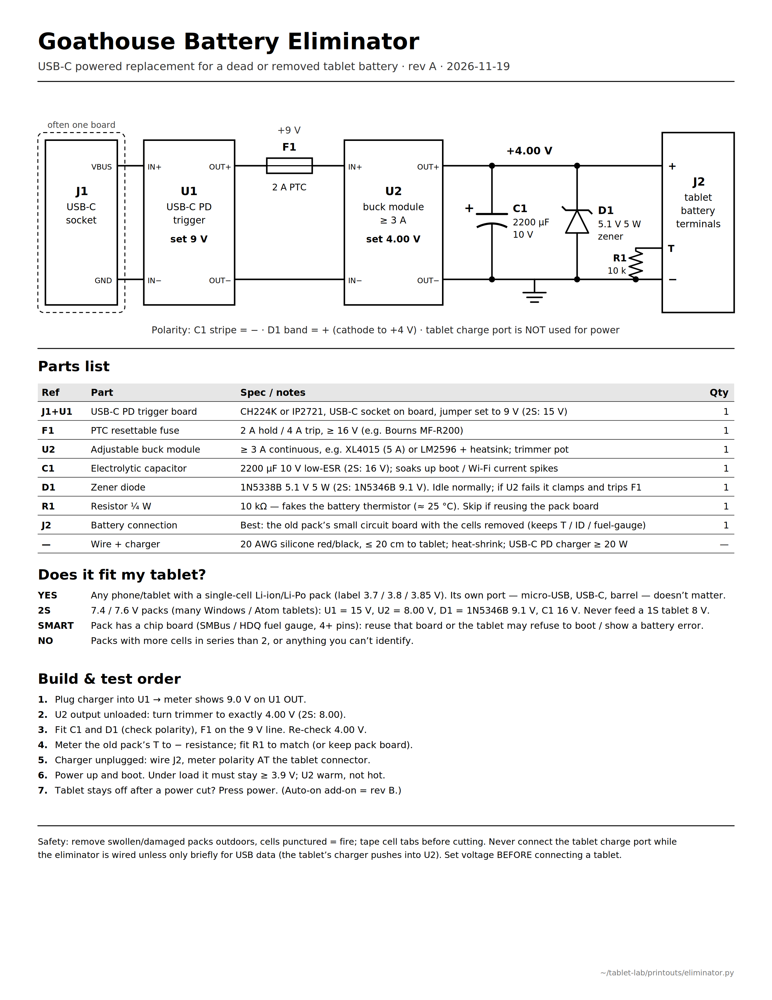

# Goathouse Battery Eliminator (rev A)

Run an old phone or tablet straight from a USB-C charger with its battery removed. That's useful for wall panels
whose packs are dead or swollen. The tablet's own charge port isn't used for power; the eliminator feeds the
battery terminals with a steady 4.00 V.

`eliminator.svg` is the printable one-page sheet (US Letter); `eliminator.py` regenerates it
(`python3 eliminator.py` writes `eliminator.svg`).

## How it works

USB-C PD trigger (asks the charger for **9 V**) → **2 A PTC** fuse → **buck converter set to 4.00 V** →
**2200 µF** reservoir capacitor and a **5.1 V 5 W zener** crowbar across the output → tablet battery `+`/`−`. A
**10 kΩ** resistor from the battery `T` pin to `−` fakes the pack thermistor at about 25 °C. If the buck ever fails
short, the zener clamps and the PTC trips before the tablet sees more than ~5 V.

## Parts list

| Ref | Part | Spec / notes | Qty |
|---|---|---|---|
| J1+U1 | USB-C PD trigger board | CH224K or IP2721, USB-C socket on board, jumper set to 9 V (2S packs: 15 V) | 1 |
| F1 | PTC resettable fuse | 2 A hold / 4 A trip, ≥ 16 V (e.g. Bourns MF-R200) | 1 |
| U2 | Adjustable buck module | ≥ 3 A continuous, e.g. XL4015 (5 A) or LM2596 + heatsink; trimmer pot | 1 |
| C1 | Electrolytic capacitor | 2200 µF 10 V low-ESR (2S: 16 V); soaks up boot / Wi-Fi current spikes | 1 |
| D1 | Zener diode | 1N5338B 5.1 V 5 W (2S: 1N5346B 9.1 V). Idle normally; if U2 fails it clamps and trips F1 | 1 |
| R1 | Resistor ¼ W | 10 kΩ, fakes the battery thermistor (≈ 25 °C). Skip if reusing the pack board | 1 |
| J2 | Battery connection | Best: the old pack's small circuit board with the cells removed (keeps T / ID / fuel gauge) | 1 |
| — | Wire + charger | 20 AWG silicone red/black, ≤ 20 cm to the tablet; heat-shrink; USB-C PD charger ≥ 20 W | — |

## Does it fit my tablet?

- **Yes:** any phone or tablet with a single-cell Li-ion/Li-Po pack (labelled 3.7 / 3.8 / 3.85 V). The tablet's
  own port (micro-USB, USB-C, barrel) doesn't matter.
- **2S packs** (7.4 / 7.6 V, many Windows/Atom tablets): U1 = 15 V, U2 = 8.00 V, D1 = 1N5346B 9.1 V, C1 16 V.
  Never feed a 1S tablet 8 V.
- **Smart packs** (a chip board with SMBus/HDQ fuel gauge, 4+ pins): reuse that board, or the tablet may refuse
  to boot or show a battery error.
- **No:** more than 2 cells in series, or anything you can't identify.

## Build and test order

1. Plug the charger into U1; the meter should show 9.0 V on U1 OUT.
2. With U2's output unloaded, turn the trimmer to exactly 4.00 V (2S: 8.00 V).
3. Fit C1 and D1 (C1 stripe = −, D1 band = +), and F1 on the 9 V line. Re-check 4.00 V.
4. Meter the old pack's T-to-− resistance and fit R1 to match (or keep the pack board).
5. With the charger unplugged, wire J2 and meter polarity **at the tablet connector**.
6. Power up and boot. Under load it must stay ≥ 3.9 V. U2 should be warm, not hot.
7. If the tablet stays off after a power cut, press power. (An auto-on add-on is planned for rev B.)

## Safety

Remove swollen or damaged packs outdoors; a punctured cell is a fire. Tape the cell tabs before cutting. Set the
voltage **before** connecting a tablet. Don't use the tablet's charge port while the eliminator is wired, except
briefly for USB data (the tablet's charger pushes back into U2).

*Field note:* one tablet rewired this way by a previous owner measured 4.83–4.90 V at the terminals. That's
too high for a 1S device, and it's the reason this design pins the output at 4.00 V and adds a crowbar.
